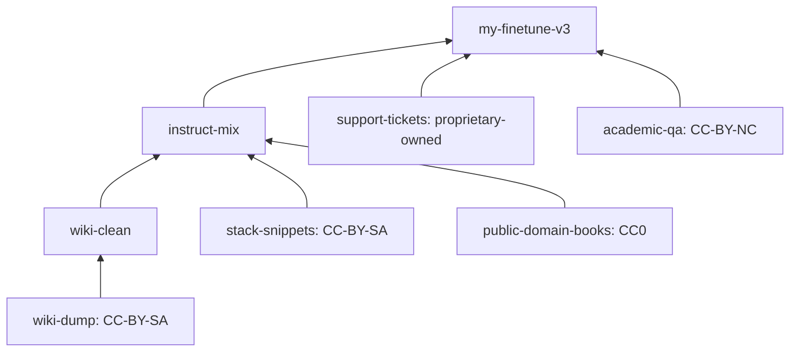

# Architecture — dataset-ancestry

## 1. Scope
Lineage and licence-obligation propagation for training datasets.
**MVP:** manifest-defined DAG (sources with licences, derived datasets with parents and
transforms), validation (unknown parents, sources without licences), cycle-checked ancestor
resolution, obligation propagation (attribution, NC, SA families, ND, restricted, unknown) and
conflicts, use checks, content hashing with a root hash and drift verification, DOT export.
**Product:** auto-ingest from dataset cards and pipeline runs, row-level provenance, signed attestations.

## 2. Model

Obligations are a property of the **sources** reachable from a dataset. Transforms don't remove
licence obligations, which is the most common misconception this tool corrects.

## 3. Rules
- **Attribution:** every `by` source. **NC:** any NC source blocks commercial uses and redistribution.
- **Share-alike:** grouped by family. More than one family is an incompatibility, and SA mixed
  with owned proprietary data is a conflict (the derivative would have to be released under SA).
- **ND:** a derivative of an ND source is a conflict. **Restricted** third-party data can't be redistributed.
- **Unknown licences** block every use until resolved, because ignorance isn't permission.

## 4. Design decisions
- **Explicit licence-flag table** over SPDX expression parsing. It's readable and reviewable by
  legal teams. *Trade-off:* it's a simplified model, labelled "triage, not legal advice".
- **Root hash** over sorted `(relpath, sha256)` pairs. It's order-independent and detects any
  added, removed or changed file.
- **Fail-closed validation at load:** a manifest with a dangling parent can't produce a misleading "allowed".

## 5. Production architecture
A lineage service fed by pipeline hooks (Airflow/Dagster/dbt emit edges), Hugging Face dataset
card parsing, Postgres (graph as adjacency + materialised closure), in-toto attestations signed
at release, and a policy check in CI before model training jobs start.

## 6. Risks
Upstream licence metadata is often wrong, so source-level evidence (licence file hash, URL
snapshot) is attached to every source node.
